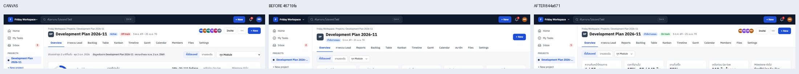
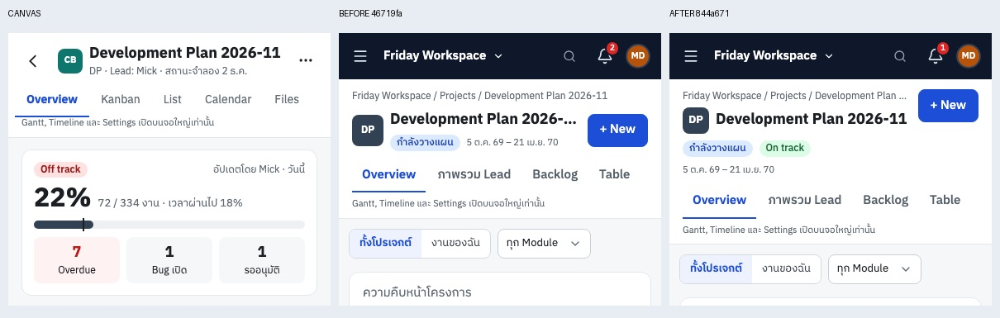

# ตรวจซ้ำ VD02 — Project header ของ PR #79

วันที่ 6 พฤศจิกายน 2569 · ตรวจ commit `844a671ac6e0dd1c4f8c47404ac31076973225ce` · [PR #79](https://github.com/WoraphonDev/Friday_Manage/pull/79)

**VD02 ผ่านในขอบเขตหัวโปรเจกต์ desktop ของ Main/Table และหน้าที่ใช้ header ร่วม** โดยหัวมือถือยังไม่เหมือน M6 และยังคงเปิด VD04/VD15 ไว้ ไม่ได้อนุมัติ UI ทั้งระบบว่าเหมือน Canvas

| รายการ | ผลตรวจ | สถานะ |
|---|---|---|
| Header ที่ 1440 / ชื่อแบบตัวอย่าง | เดิม152 →125px; Canvas125px; tabs y136 ตรงแบบ | ผ่าน |
| ชื่อ/สถานะ/Health/วันที่ | อยู่แถวเดียวกัน; icon32px; IBM Plex Sans Thai โหลดครบ | ผ่าน |
| Avatar / Invite / ⋯ / + New | แสดงครบสำหรับผู้มีสิทธิ์; activeสมาชิก4คนตรงAPI | ผ่าน |
| ปุ่ม Invite | เปิด Members แท็บคำเชิญจริงด้วย `#invites` | ผ่าน |
| เมนู ⋯ | Settings/Automation/Plan changes เปิดได้; Escape ปิดได้ | ผ่าน |
| + New | เปิด dialog สร้างงานจริง | ผ่าน |
| Guest UI | จำลอง permission response: ไม่เรียก members และไม่แสดง Invite/⋯/New | ผ่านเฉพาะเงื่อนไข UI |
| ภาษาอังกฤษ | ตั้ง cookie และจำลอง account locale=en; labelใหม่แสดงได้ | ผ่านเฉพาะ UI |
| ชื่อยาว97ตัวอักษร | UI205px / Canvas203px; ทั้งสอง wrap และไม่ล้นจอ | ตามพฤติกรรมแบบ |
| ชื่อไม่เว้นวรรค112ตัวอักษร | UI272.19px ไม่ล้นจอ; Canvas241.59px และล้นถึง1795px | ไม่ถือเป็น defect ใหม่ของ UI |
| มือถือ390 | Header200px จากเดิม168.5px (+31.5); รวม topbar256px; M6รวม127px | รอ VD04/VD15 |

## ภาพหลักฐาน

Canvas อยู่ซ้าย → ก่อนแก้อยู่กลาง → หลังแก้อยู่ขวา

- [ภาพเมนูใหม่](canvas-vd02-verification-2026-11-06/project-menu-1440.png)
- [ชื่อยาว — UI](canvas-vd02-verification-2026-11-06/long-title-actual-1440.png) / [Canvas](canvas-vd02-verification-2026-11-06/long-title-canvas-1440.png)
- [ชื่อไม่เว้นวรรค — UI](canvas-vd02-verification-2026-11-06/unbroken-title-actual-1440.png) / [Canvas](canvas-vd02-verification-2026-11-06/unbroken-title-canvas-1440.png)
- [English header](canvas-vd02-verification-2026-11-06/english-1440.png) / [Guest UI](canvas-vd02-verification-2026-11-06/guest-1440.png)
- [ผลวัด/route/checks JSON](canvas-vd02-verification-2026-11-06/results.json)

## ความครอบคลุมและการทดสอบ

- Playwright + Chromium153; แยก browser/profile; locale th-TH และ timezone Asia/Bangkok; DPR1
- ตรวจ header 13เส้นทาง ×2ขนาด: Overview, Table, Kanban, Timeline, Gantt, Calendar, Members, Files, Backlog, Settings/Workflow, Lead dashboard, Reports, Automation
- ภาพ header26ภาพ ไม่มี JS page error, API error หรือ document overflow; ทั้งหมดได้ desktop125px / mobile200px ใน fixture เดียวกัน
- Browser interaction checks8/8ผ่าน; shell tests13/13ผ่าน; web typecheckผ่าน; production Webpack buildผ่าน
- ใช้ฐานข้อมูลสมมติ `friday_codex_audit2_20261106` เดิมที่แยกไว้ ไม่ใช้ `friday_canvas_qa`; ไม่ลบ/ชำระเงิน/เชิญบุคคลจริง
- Guest/English/ชื่อยาวใช้ response override เฉพาะbrowser ไม่ใช่การทดสอบ security/RLS หรือการบันทึกภาษาในบัญชี
- ภาพอ้างอิงใช้วิธี reconstruct เดียวกับ [auditเดิม](canvas-design-audit-2026-11-06.md) เพราะ repo ขาด runtime; ไม่ใช่ native Canvas export

## ข้อสังเกตให้รอบถัดไป

1. มือถือสูงขึ้น31.5px เพราะ metadata wrap เพิ่ม ต้องทำ app bar ตาม M6 ใน VD04/VD15 ก่อนปิด mobile acceptance; ไม่ใช้ตัวเลข175pxในบันทึกเดิมกับทุกข้อมูล
2. คง VD01 (Sidebar240pxแทน≈221px) และ VD03 (context shell) ไว้ ไม่ถือว่า PRนี้แก้แล้ว
3. คงแท็บ Reports ตามที่ PR ระบุว่ามาจาก W15/O1/O2; ไม่ถือว่าการเก็บแท็บนี้ทำให้ทั้งแถบตรง Main แบบ pixel-perfect
4. แก้ความหมายเกณฑ์เดิม VD02 เรื่องชื่อยาว: Canvasเอง wrap และสูงขึ้น จึงไม่ควรบังคับ125pxกับทุกชื่อ ให้เทียบ state/ชื่อเดียวกันและรักษาปุ่ม/การอ่านโดยไม่ล้นจอ

ผลครั้งนี้เป็นการตรวจ source ของ Claude และเพิ่มเอกสาร/หลักฐาน ไม่แก้โค้ดผลิตภัณฑ์ ไม่ merge PR
