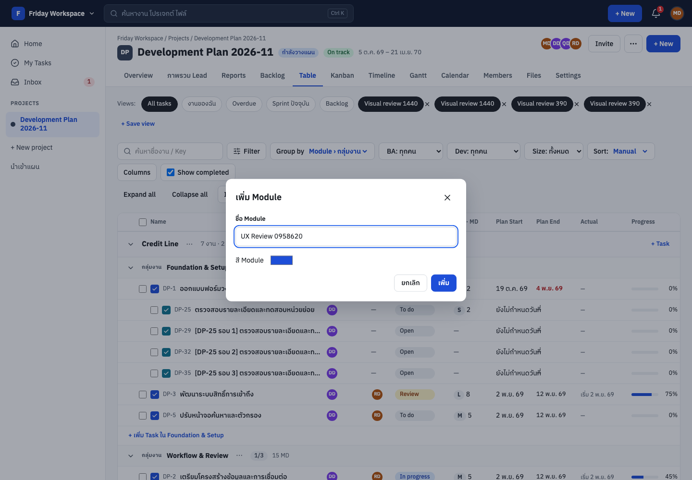

# ผลตรวจ UI/UX และแก้ไขตาม Canvas — 7 พฤศจิกายน 2569

แก้ **11 กลุ่มปัญหาการใช้งาน** ใน branch `fix/canvas-ux-review` โดยเฉพาะการเพิ่ม Module ที่เคยพาไป Settings ตอนนี้เพิ่ม/เปลี่ยนชื่อ Module และกลุ่มงานใน Table ได้เลย ใช้ endpoint เดิม ไม่แก้ schema หรือ endpoint ฝั่ง server ในรอบนี้

[เปิดภาพเทียบ Canvas / ก่อน / หลัง](ui-ux-review-2026-11-07/index.html) · [ผลทดสอบ workflow](ui-ux-review-2026-11-07/workflow-results.json) · [สถานะ Design JSON](ui-ux-review-2026-11-07/design-status.json)

## สิ่งที่แก้แล้ว

| ID | เรื่อง | ผลหลังแก้ |
|---|---|---|
| UF01 | จัด Module/กลุ่มงานใน Table | เพิ่ม Module, เปลี่ยนชื่อ Module, เพิ่ม/เปลี่ยนชื่อกลุ่มงานใน Dialog ของหน้าเดิม; แสดงกลุ่มว่างและเลื่อนไปกลุ่มใหม่แม้ตาราง virtualized |
| UF02 | สร้าง Task ในบริบทที่กด | +Task ของ Module/Phase ส่ง moduleId/phaseId ไปฟอร์ม พร้อมแยกร่างแต่ละกลุ่มและตัด ID ที่ไม่มีใน options |
| UF03 | ข้อมูลหลังสร้างและการปิด Drawer | รีเฟรช Table/Overview/Kanban/Timeline/Gantt/Calendar/Backlog หลังบันทึก; ล้าง type/moduleId/phaseId/statusId/parent เมื่อออกจากฟอร์ม; ใช้ cache=no-store เพื่อไม่ให้ HTTP cache คืน Module/ลูกงานเก่าหลัง invalidate แม้ ETag หลักคงเดิม |
| UF04 | สร้างการ์ด Kanban ตามคอลัมน์ | เลือกสถานะจากคอลัมน์และ Module จาก swimlane/ตัวกรอง ไม่เริ่มฟอร์มว่างที่เสียบริบท |
| UF05 | เพิ่ม Milestone ใน Timeline | ปุ่ม +Milestone เปิดฟอร์มในหน้าเดิมและรีเฟรชเส้นเป้าหมาย ใช้ API ที่มีอยู่ |
| UF06 | Views Sprint/Backlog | เพิ่มตัวกรอง Sprint ปัจจุบัน/Backlog ที่ API รองรับอยู่แล้ว แทนการเว้น controls ของ Canvas |
| UF07 | Sub-task มือถือและผลทดสอบ | 4แท็บ รายละเอียด/ผลทดสอบ/Commits/คอมเมนต์; ใช้ QA API จริง บันทึกผลและสร้าง Bug จากผลไม่ผ่าน; composer คงร่างและส่งได้ทุกแท็บ; แสดงรายการ commit ทั้งหมดพร้อมลิงก์และลิงก์ไฟล์หลักฐาน QA |
| UF08 | สิทธิ์อ่านเห็นข้อมูลสำคัญ | แสดง Checklist/Dependencies ให้สมาชิกอ่านอย่างเดียว พร้อมปิดการแก้ไข แทนการซ่อนข้อมูลทั้งส่วน |
| UF09 | ค้นหาในเมนู Projects มือถือ | แก้ CSS ที่ซ่อนข้อความและเพิ่ม accessible name; ปุ่มค้นหากว้างเต็มแถว เปิด palette ได้จริง |
| UF10 | ผลตรวจ Import มือถือ | วางข้อความผลตรวจใต้ชื่องานในคอลัมน์กว้าง แทนการไหลลงช่องไอคอนจนอ่านแทบทีละตัวอักษร |
| UF11 | เมนูคำสั่งใช้รูปแบบเดียวกัน | ล้างกรอบ/พื้นของ browser จาก button.menu-item ให้คำสั่งใน popup เหมือนรายการที่ใช้ Link |

## บั๊กแคชที่พบเมื่อทดสอบทางสั้น

เพิ่ม Module แล้วสร้าง Task ทันที เคยบันทึกถูก Module แต่รายละเอียดแสดง Module แรก เพราะ ETag ของ GET project อิง version ที่ไม่เปลี่ยนเมื่อเพิ่ม Module และ fetch ใช้ HTTP cache ตามค่าเดิม แก้ ApiClient ให้ใช้ cache=no-store เป็นค่าเริ่มต้น โดยคง React Query cache และ ETag/If-Match สำหรับการเขียนข้อมูลไว้

[หลักฐานก่อนแก้](ui-ux-review-2026-11-07/workflows/module-cache-before-1440.png) · [หลังแก้](ui-ux-review-2026-11-07/workflows/module-cache-after-1440.png) · [ข้อมูล regression](ui-ux-review-2026-11-07/cache-regression.json)

## หลักฐานหลัก

- [Table หลังเพิ่มกลุ่มงานและ Task](ui-ux-review-2026-11-07/workflows/table-after-create-1440.png)
- [ฟอร์ม Module ที่390px](ui-ux-review-2026-11-07/workflows/module-dialog-390.png)
- [Sub-task ผลทดสอบมือถือ](ui-ux-review-2026-11-07/workflows/subtask-tests-390.png) · [คอมเมนต์มือถือ](ui-ux-review-2026-11-07/workflows/subtask-comments-390.png)
- [ผลตรวจ Import ที่อ่านได้บนมือถือ](ui-ux-review-2026-11-07/workflows/import-step3-390.png)

## วิธีตรวจและขอบเขต

- ก่อนแก้ใช้ build `0a64b96`; หลังแก้ใช้ source `bb637785da6168016a694df617d22d13b43dbf44` ต่อจากงาน Claude `d649b02` และ PR83 รวมการเลือก Sidebar/แท็บคงที่และแกน Timeline ตาม Gantt ไว้ ไม่ย้อนการตัดสินใจที่บันทึก 2026-11-07
- Chromium153 + Playwright; viewport1440×ความสูงบอร์ดและ390×844, DPR1, locale th-TH, timezone Asia/Bangkok; profile/browser แยกจาก Chrome ของผู้ใช้
- Canvas51บอร์ด /96ภาพอ้างอิง; ภาพ UI ก่อน93และหลัง93ภาพ; M1เพิ่ม12ภาพของ6สถานะ; ReviewGuide/States/Localization เป็น guide/pattern จึงไม่ตัดสินว่าขาด route; กระดิ่งมือถือใช้ Inbox แทน popup K4
- ตรวจองค์ประกอบทุกบอร์ดผ่านภาพคู่/สามภาพและ contact sheets; เปิด flow จริงที่แก้ ไม่ใช้จำนวน test ที่ผ่านแทน visual acceptance
- ภาพอ้างอิง reconstruct จาก HTML/CSS Canvas ที่ล็อกไว้ กับ render shim เนื่องจาก repo ขาด runtime; ใช้ IBM Plex Sans Thai จากไฟล์ตระกูลเดียวกัน; ไม่แก้ design ต้นฉบับและไม่ใช่ native Canvas export
- ข้อมูลจำนวนงาน ชื่อ วัน และราคาไม่ตรงกับตัวอย่าง จึงไม่คำนวณเปอร์เซ็นต์ pixel similarity; TaskCreate มี annotation/คำสอนใน Canvas ซึ่งไม่ใช่ส่วนของหน้าผลิตภัณฑ์
- ใช้ DB `friday_codex_audit2_20261106` สำหรับ browser/ข้อมูลสมมติ; ชุดทดสอบที่ล้างข้อมูลใช้ DBใหม่ `friday_ux_tests_20261107`; migrationถึง0012; ไม่ใช้ DB `friday_canvas_qa` หรือข้อมูลผู้ใช้จริง
- Guest/readonly conditions และ M1 ใช้ response จำลองเฉพาะ browser; ไม่ใช่การยืนยัน authorization/RLS; ไม่กดยืนยันลบ ชำระเงิน หรือส่งคำเชิญบุคคลจริง
- ตรวจสถานะหลักที่ระบุ ไม่ได้ไล่ทุกแท็บ/ทุก configuration/ทุกบทบาท/ทุก provider; ช่องทางบริการจริง เช่น OAuth, Email, LINE ไม่ได้รับการรับรองจากการตรวจภาพ

## ผลทดสอบ

- workflow browser **15/15 ผ่าน**; page errorsในworkflow 0
- source เว็บผ่าน typecheck/production build และชุด component tests; pnpm test ทั้ง repo ผ่าน1286และข้าม6; เว็บฉบับสุดท้ายผ่าน436 รวมผลล่าสุดแต่ละแพ็กเกจ1287; ดู [validation.json](ui-ux-review-2026-11-07/validation.json)
- ภาพหลังแก้ปกติ93ภาพ: page errors 0, state mismatch 0, document overflowแนวนอน 0; Table/Ganttที่ต้องเลื่อนภายในไม่ถือเป็น document overflow
- ทดสอบตาราง450แถวเพื่อยืนยันว่ากลุ่มใหม่ปรากฏได้แม้อยู่พ้นช่วง virtualized; ทดสอบบันทึกไม่ผ่านแล้วคงชื่อ/requestId; IDบริบทที่ไม่อยู่ใน options ถูกตัดทิ้ง

## สถานะ VD01–VD26 หลังตรวจรอบนี้

นี่คือสถานะของ state ที่เก็บภาพ ไม่ใช่คำยืนยันว่าเหมือนทุก pixel หรือทุก interaction; ยังมีส่วนที่ต้องต่อ UI/API เพิ่มตามตาราง

| ID | เรื่อง | สถานะ | หมายเหตุ |
|---|---|---|---|
| VD01 | Sidebar desktop กว้างและจัดเมนูต่างจากแบบ | ผ่านในสถานะที่ตรวจ | ภาพและองค์ประกอบหลักผ่านใน fixture/state ที่ระบุ; ไม่ใช่การรับรองทุกข้อมูลและ interaction |
| VD02 | Project header สูญเสียองค์ประกอบและสูงกว่า Canvas | ผ่านในสถานะที่ตรวจ | ภาพและองค์ประกอบหลักผ่านใน fixture/state ที่ระบุ; ไม่ใช่การรับรองทุกข้อมูลและ interaction |
| VD03 | หน้าบริบทเฉพาะยังถูกครอบด้วย Workspace/Project shell เต็มชุด | ต่างโดยตั้งใจ | เลือกต่างจาก Canvas: คง Sidebar/แท็บเพื่อไม่ให้ทางนำทางเปลี่ยนเมื่อสลับหน้า ตามการตัดสินใจที่บันทึกไว้ 2026-11-07 |
| VD04 | Mobile app bar และ bottom navigation ไม่ตรง M2–M7 | ผ่านในสถานะที่ตรวจ | ภาพและองค์ประกอบหลักผ่านใน fixture/state ที่ระบุ; ไม่ใช่การรับรองทุกข้อมูลและ interaction |
| VD05 | Overview summary เปลี่ยนจากการ์ดรวมเป็น 5 การ์ด | ผ่านในสถานะที่ตรวจ | ภาพและองค์ประกอบหลักผ่านใน fixture/state ที่ระบุ; ไม่ใช่การรับรองทุกข้อมูลและ interaction |
| VD06 | Overview KPI/list/ข้อมูลโปรเจกต์จัดใหม่คนละโครง | ผ่านในสถานะที่ตรวจ | ภาพและองค์ประกอบหลักผ่านใน fixture/state ที่ระบุ; ไม่ใช่การรับรองทุกข้อมูลและ interaction |
| VD07 | Table toolbar ขาดชุดควบคุมในแบบ | ยังไม่ปิด | Toolbar/Views แก้แล้ว แต่ FR/Screen ยังไม่มีข้อมูลในแถว API |
| VD08 | Table ใช้ native select ทุกแถวและสลับชุดคอลัมน์ | ยังไม่ปิด | Status pill และ columns หลักตรงขึ้น; FR/Screen ยังขาด |
| VD09 | Table bulk bar และ action ของแถวอยู่ผิดตำแหน่ง | ผ่านในสถานะที่ตรวจ | ภาพและองค์ประกอบหลักผ่านใน fixture/state ที่ระบุ; ไม่ใช่การรับรองทุกข้อมูลและ interaction |
| VD10 | Task create drawer ใช้กรอบเดียวกับ detail และ form arrangement ต่าง | ยังไม่ปิด | Drawer/บริบทสร้างงานแก้แล้ว; Requirement/Screen/Labels/Watchers ของฟอร์ม B ยังไม่ครบ |
| VD11 | สร้าง Bug/Story/Spike ใช้ drawer แทน centered modal | ผ่านในสถานะที่ตรวจ | ภาพและองค์ประกอบหลักผ่านใน fixture/state ที่ระบุ; ไม่ใช่การรับรองทุกข้อมูลและ interaction |
| VD12 | Task/Bug detail เปลี่ยน information architecture | ยังไม่ปิด | โครงรายละเอียดและ QA ของ Sub-task แก้แล้ว; Requirement/Screen/Labels ยังไม่ครบ |
| VD13 | Sub-task มี parent navigation ซ้ำและ rail/พื้นที่เนื้อหาต่าง | ผ่านในสถานะที่ตรวจ | Rail ของ desktop คงไว้; มือถือไม่ซ้ำ parent bar และ Commits แสดงทุกรายการพร้อมลิงก์/ผู้เขียน/วันที่ |
| VD14 | Mobile Home ยังเป็น desktop ที่ยุบคอลัมน์ | ผ่านในสถานะที่ตรวจ | ภาพและองค์ประกอบหลักผ่านใน fixture/state ที่ระบุ; ไม่ใช่การรับรองทุกข้อมูลและ interaction |
| VD15 | Mobile Overview ไม่ใช้ summary compact ของ M6 | ผ่านในสถานะที่ตรวจ | ภาพและองค์ประกอบหลักผ่านใน fixture/state ที่ระบุ; ไม่ใช่การรับรองทุกข้อมูลและ interaction |
| VD16 | Mobile My Tasks/Inbox ไม่ใช้โครง toolbar และ list ของ M2/M3 | ผ่านในสถานะที่ตรวจ | ภาพและองค์ประกอบหลักผ่านใน fixture/state ที่ระบุ; ไม่ใช่การรับรองทุกข้อมูลและ interaction |
| VD17 | Mobile Kanban toolbar/card actions ต่างจาก M7 | ผ่านในสถานะที่ตรวจ | ภาพและองค์ประกอบหลักผ่านใน fixture/state ที่ระบุ; ไม่ใช่การรับรองทุกข้อมูลและ interaction |
| VD18 | Mobile Sub-task properties ดันเนื้อหาหลักพ้นจอ | ผ่านในสถานะที่ตรวจ | เพิ่มแท็บ M4, QA API, คุณสมบัติหลัก4แถว และ composer ที่กดส่งได้ทุกแท็บ |
| VD19 | Import บนมือถือ: เมนูล่างบังปุ่มถัดไปจนแตะไม่ได้ | ผ่านในสถานะที่ตรวจ | ปุ่ม step2 ใช้ pointer ได้ และแก้กริดผลตรวจมือถือให้อ่านได้ |
| VD20 | Profile notification connections ขาดการ์ดกลุ่มทีม | ผ่านในสถานะที่ตรวจ | source ปัจจุบันมีการ์ดกลุ่มทีมครบ4ใบ |
| VD21 | Invite dialog ใช้ controls/สัดส่วนต่างจาก H | ผ่านในสถานะที่ตรวจ | ภาพและองค์ประกอบหลักผ่านใน fixture/state ที่ระบุ; ไม่ใช่การรับรองทุกข้อมูลและ interaction |
| VD22 | Due request dialog ขาดตัวเพิ่มวันและจัดส่วนผลกระทบต่าง | ผ่านในสถานะที่ตรวจ | แก้เกณฑ์ audit เดิม: K3 ไม่มีตัวเพิ่ม Nวันแยก ต้องตรวจคู่วันที่และผลกระทบ preview แทน |
| VD23 | Delete confirmation ไม่มีตัวเลือกจัดการ Sub-task ตาม P3 | ผ่านในสถานะที่ตรวจ | ภาพและองค์ประกอบหลักผ่านใน fixture/state ที่ระบุ; ไม่ใช่การรับรองทุกข้อมูลและ interaction |
| VD24 | Notification toast ไม่รองรับ action ใน Canvas K4 | ยังไม่ปิด | Toast รองรับ actor/secondary/actions และ Bell แสดงรายการ; ยังไม่ยืนยัน realtime/action ทุกเหตุการณ์กับบริการจริง |
| VD25 | Command palette อยู่สูงกว่าแบบ 56 px | ผ่านในสถานะที่ตรวจ | ภาพและองค์ประกอบหลักผ่านใน fixture/state ที่ระบุ; ไม่ใช่การรับรองทุกข้อมูลและ interaction |
| VD26 | New Project template choices จัด grid ต่างจาก A | ผ่านในสถานะที่ตรวจ | ภาพและองค์ประกอบหลักผ่านใน fixture/state ที่ระบุ; ไม่ใช่การรับรองทุกข้อมูลและ interaction |

## แก้เกณฑ์ตรวจเดิมที่คลาดเคลื่อน

- **VD22:** จากการอ่าน K3 ต้นฉบับซ้ำ Canvasไม่มีตัวเพิ่ม Nวันทำการแยก จึงไม่ควรเพิ่ม control นี้โดยไม่จำเป็น ให้ตรวจคู่ Due เดิม→ใหม่ และผลกระทบ preview ที่ใช้อยู่จริง
- **VD02:** ความสูง125pxใช้กับชื่อแบบตัวอย่าง; Canvasเอง wrap เมื่อชื่อยาว จึงไม่บังคับทุกชื่อให้สูงเท่ากัน ให้ตรวจชื่อเดียวกันและไม่ล้นจอ
- **VD03:** Sidebar/แท็บคงที่เป็นการเลือกเพื่อการใช้งานจริงตามบันทึกใน repo ไม่ถือเป็น defect ที่ต้องเปลี่ยนกลับให้หายเมื่อเปลี่ยนหน้า

## คำขอนอก lane และเหตุผลที่ทำ

ผู้ใช้อนุญาตให้แก้สิ่งที่ไม่สมเหตุสมผลได้โดยตรง จึงรวม W05 (Table), W02 (บริบทสร้างงาน/QA/M4), W06 (Kanban), W07 (Milestone), W14 (Import responsive) และ W00 (API cache/ล้าง query/ค้นหามือถือ/สไตล์เมนู) ใน branchแยก ไม่เขียนทับ checkout ที่ Claude กำลังแก้ และคง API permissions เดิม ข้อความใหม่มีทั้งTH/EN

## ความครอบคลุมรายบอร์ด

| บอร์ด | เส้นทาง/สถานะ | ข้อสังเกต |
|---|---|---|
| 0 · เริ่มที่นี่ — คู่มือ Review | `—` | คู่มือ review ไม่มีหน้าผลิตภัณฑ์คู่ตรง |
| 1 · Overview | `/w/visual-audit/p/DP` | เทียบองค์ประกอบและ flow โดยแยกชื่อ จำนวนงาน วันที่ และข้อมูลตัวอย่างออกจากความต่างของ layout |
| 2 · Table (Module › Task › Sub-task) | `/w/visual-audit/p/DP/table` | เทียบองค์ประกอบและ flow โดยแยกชื่อ จำนวนงาน วันที่ และข้อมูลตัวอย่างออกจากความต่างของ layout |
| 3 · Kanban (drag & drop) | `/w/visual-audit/p/DP/board` | เทียบองค์ประกอบและ flow โดยแยกชื่อ จำนวนงาน วันที่ และข้อมูลตัวอย่างออกจากความต่างของ layout |
| 4 · Timeline (Module › Task › Sub-task) | `/w/visual-audit/p/DP/timeline` | เทียบองค์ประกอบและ flow โดยแยกชื่อ จำนวนงาน วันที่ และข้อมูลตัวอย่างออกจากความต่างของ layout |
| 5 · Gantt | `/w/visual-audit/p/DP/gantt` | เทียบองค์ประกอบและ flow โดยแยกชื่อ จำนวนงาน วันที่ และข้อมูลตัวอย่างออกจากความต่างของ layout |
| 6 · Calendar | `/w/visual-audit/p/DP/calendar` | เทียบองค์ประกอบและ flow โดยแยกชื่อ จำนวนงาน วันที่ และข้อมูลตัวอย่างออกจากความต่างของ layout |
| 7 · Members + Workload | `/w/visual-audit/p/DP/members` | เทียบองค์ประกอบและ flow โดยแยกชื่อ จำนวนงาน วันที่ และข้อมูลตัวอย่างออกจากความต่างของ layout |
| 8 · Files (Attachments) | `/w/visual-audit/p/DP/files` | เทียบองค์ประกอบและ flow โดยแยกชื่อ จำนวนงาน วันที่ และข้อมูลตัวอย่างออกจากความต่างของ layout |
| A · + New Project (Wizard 5 ขั้น) | `/w/visual-audit/new-project` | เทียบองค์ประกอบและ flow โดยแยกชื่อ จำนวนงาน วันที่ และข้อมูลตัวอย่างออกจากความต่างของ layout |
| B · สร้าง Task / Sub-task | `/w/visual-audit/p/DP?new=1&type=task` | ใช้ type=task และฟอร์ม B; กล่องสอน/พื้น skeleton ใน Canvas เป็น annotation ไม่ใช่ส่วนที่ต้องสร้างใน UI จริง |
| C · Task Detail (Drawer ด้านขวา) | `/w/visual-audit/p/DP?issue=DP-1` | เทียบองค์ประกอบและ flow โดยแยกชื่อ จำนวนงาน วันที่ และข้อมูลตัวอย่างออกจากความต่างของ layout |
| D · Sub-task Detail (Drawer ซ้อนบน Task) | `/w/visual-audit/p/DP?issue=DP-25` | เทียบองค์ประกอบและ flow โดยแยกชื่อ จำนวนงาน วันที่ และข้อมูลตัวอย่างออกจากความต่างของ layout |
| E · Home | `/w/visual-audit` | เทียบองค์ประกอบและ flow โดยแยกชื่อ จำนวนงาน วันที่ และข้อมูลตัวอย่างออกจากความต่างของ layout |
| F · My Tasks | `/w/visual-audit/my-tasks` | เทียบองค์ประกอบและ flow โดยแยกชื่อ จำนวนงาน วันที่ และข้อมูลตัวอย่างออกจากความต่างของ layout |
| G · Inbox (Notifications) | `/w/visual-audit/inbox?n=01a1b109-613b-797c-b41e-03ccf0ef124c` | เทียบองค์ประกอบและ flow โดยแยกชื่อ จำนวนงาน วันที่ และข้อมูลตัวอย่างออกจากความต่างของ layout |
| H · Workspace Members + Invite | `/w/visual-audit/members` | เทียบองค์ประกอบและ flow โดยแยกชื่อ จำนวนงาน วันที่ และข้อมูลตัวอย่างออกจากความต่างของ layout |
| I · User Profile + Notification settings | `/w/visual-audit/profile` | เทียบองค์ประกอบและ flow โดยแยกชื่อ จำนวนงาน วันที่ และข้อมูลตัวอย่างออกจากความต่างของ layout |
| J1 · Login (+ 2FA) | `/login` | เทียบองค์ประกอบและ flow โดยแยกชื่อ จำนวนงาน วันที่ และข้อมูลตัวอย่างออกจากความต่างของ layout |
| J2 · Sign up + ยืนยันอีเมล | `/signup` | เทียบองค์ประกอบและ flow โดยแยกชื่อ จำนวนงาน วันที่ และข้อมูลตัวอย่างออกจากความต่างของ layout |
| J3 · ลืมรหัสผ่าน (3 ขั้น) | `/forgot-password` | เทียบองค์ประกอบและ flow โดยแยกชื่อ จำนวนงาน วันที่ และข้อมูลตัวอย่างออกจากความต่างของ layout |
| J4 · รับคำเชิญ | `/join/<test-token>` | เทียบองค์ประกอบและ flow โดยแยกชื่อ จำนวนงาน วันที่ และข้อมูลตัวอย่างออกจากความต่างของ layout |
| J5 · Onboarding (สร้าง Workspace) | `/onboarding` | เทียบองค์ประกอบและ flow โดยแยกชื่อ จำนวนงาน วันที่ และข้อมูลตัวอย่างออกจากความต่างของ layout |
| K1 · สร้างงานตามประเภท (Story / Task / Bug / Spike) | `/w/visual-audit/p/DP?new=1&type=bug` | เทียบองค์ประกอบและ flow โดยแยกชื่อ จำนวนงาน วันที่ และข้อมูลตัวอย่างออกจากความต่างของ layout |
| K2 · Bug Detail | `/w/visual-audit/p/DP?issue=DP-26` | เทียบองค์ประกอบและ flow โดยแยกชื่อ จำนวนงาน วันที่ และข้อมูลตัวอย่างออกจากความต่างของ layout |
| K3 · ขอเลื่อน Due | `/w/visual-audit/p/DP?issue=DP-2` | เทียบองค์ประกอบและ flow โดยแยกชื่อ จำนวนงาน วันที่ และข้อมูลตัวอย่างออกจากความต่างของ layout |
| K4 · กระดิ่งแจ้งเตือน + Toast + Global top bar | `/w/visual-audit/p/DP` | มือถือใช้ Inbox (M3) แทน popup K4; การส่งจริง/realtime ยังต้องทดสอบช่องทางบริการเพิ่มเติม |
| L1 · Backlog + Sprint planning | `/w/visual-audit/p/DP/backlog` | เทียบองค์ประกอบและ flow โดยแยกชื่อ จำนวนงาน วันที่ และข้อมูลตัวอย่างออกจากความต่างของ layout |
| L2 · Project Settings | `/w/visual-audit/p/DP/settings/workflow` | เทียบองค์ประกอบและ flow โดยแยกชื่อ จำนวนงาน วันที่ และข้อมูลตัวอย่างออกจากความต่างของ layout |
| M1 · สถานะหน้าจอ (Empty · Loading · Error · 403 · 404 · Viewer) | `/dev/ui` | M1 เป็นบอร์ดรวม pattern ดูภาพสถานะจริง 6 แบบด้านล่าง ไม่ถือว่า /dev/ui ใน production ต้องเปิดได้ |
| M2 · Mobile · My Tasks | `/w/visual-audit/my-tasks` | เทียบองค์ประกอบและ flow โดยแยกชื่อ จำนวนงาน วันที่ และข้อมูลตัวอย่างออกจากความต่างของ layout |
| M3 · Mobile · Inbox | `/w/visual-audit/inbox` | เทียบองค์ประกอบและ flow โดยแยกชื่อ จำนวนงาน วันที่ และข้อมูลตัวอย่างออกจากความต่างของ layout |
| M4 · Mobile · Sub-task Detail | `/w/visual-audit/p/DP?issue=DP-25` | 4แท็บ ข้อมูลทดสอบจริง ช่องคอมเมนต์คงร่างและกดส่งได้; คุณสมบัติเพิ่มเติมเปิดจากปุ่ม |
| L3 · Import Excel + การแก้ไขแผน (Plan vs Actual) | `/w/visual-audit/import` | ตรวจ step3 จาก Excel สมมติ ไม่กดยืนยันนำเข้า; pointer step2 และความกว้างข้อความผลตรวจผ่าน workflow |
| N1 · Admin Console (Workspace / SaaS) | `/w/visual-audit/admin` | เทียบองค์ประกอบและ flow โดยแยกชื่อ จำนวนงาน วันที่ และข้อมูลตัวอย่างออกจากความต่างของ layout |
| O1 · Lead Dashboard (ข้อมูลจริง Development Plan 2026-11) | `/w/visual-audit/p/DP/dashboard` | คง Sidebar/หัว/แท็บตามการตัดสินใจของผู้ใช้ที่บันทึก 2026-11-07 ต่างจาก O1 โดยตั้งใจ |
| O2 · Reports + Requirement Traceability | `/w/visual-audit/p/DP/reports` | คงการนำทางร่วมตามการใช้งานจริง ต่างจาก O2 โดยตั้งใจ |
| N2 · หน้าตาข้อความแจ้งเตือน (LINE · Email · Webhook) | `/w/visual-audit/admin/notify-templates` | เทียบองค์ประกอบและ flow โดยแยกชื่อ จำนวนงาน วันที่ และข้อมูลตัวอย่างออกจากความต่างของ layout |
| M5 · Mobile · Home | `/w/visual-audit` | เทียบองค์ประกอบและ flow โดยแยกชื่อ จำนวนงาน วันที่ และข้อมูลตัวอย่างออกจากความต่างของ layout |
| M6 · Mobile · Project Overview | `/w/visual-audit/p/DP` | เทียบองค์ประกอบและ flow โดยแยกชื่อ จำนวนงาน วันที่ และข้อมูลตัวอย่างออกจากความต่างของ layout |
| M7 · Mobile · Kanban (ย้ายด้วยปุ่ม) | `/w/visual-audit/p/DP/board` | เทียบองค์ประกอบและ flow โดยแยกชื่อ จำนวนงาน วันที่ และข้อมูลตัวอย่างออกจากความต่างของ layout |
| P1 · ค้นหา + Command palette (Ctrl K) | `/w/visual-audit/p/DP` | เทียบองค์ประกอบและ flow โดยแยกชื่อ จำนวนงาน วันที่ และข้อมูลตัวอย่างออกจากความต่างของ layout |
| P2 · Automation (เมื่อ … ถ้า … ให้ …) | `/w/visual-audit/p/DP/automation` | คง Sidebar; หน้า Automation มี breadcrumb ของตัวเอง |
| P3 · Dialog ยืนยัน + เลิกทำ | `/w/visual-audit/p/DP?issue=DP-1` | เปิดตัวเลือกลบโดยไม่ยืนยันลบ |
| Q1 · สลับ Workspace + สร้างใหม่ | `/w/visual-audit` | เทียบองค์ประกอบและ flow โดยแยกชื่อ จำนวนงาน วันที่ และข้อมูลตัวอย่างออกจากความต่างของ layout |
| Q2 · เมื่อใช้เกินแพ็กเกจ (7 สถานการณ์) | `/w/visual-audit/p/DP` | จำลอง402เพื่อเปิด seat limit ไม่เปลี่ยนแพ็กเกจ |
| Q3 · Super Admin (หลังบ้านทีม Friday) | `/workspaces?id=01a1b109-5e9e-71af-a255-df792c41914c` | ใช้ session สมมติของ staff ไม่ใช่การทดสอบ WebAuthn จริง |
| R1 · Landing + ราคาเหมาตามขนาดทีม (TH / EN) | `/` | เทียบองค์ประกอบและ flow โดยแยกชื่อ จำนวนงาน วันที่ และข้อมูลตัวอย่างออกจากความต่างของ layout |
| R2 · ชำระเงิน (บัตร · PromptPay · โอน + หัก ณ ที่จ่าย) | `/w/visual-audit/billing/checkout?plan=team_m` | เลือกโอนเงินและหัก ณ ที่จ่าย แต่ไม่ขอ invoice/ชำระ; ข้อมูลก่อนออก invoice ไม่ใช่หน้าหลังออก invoice |
| R3 · ภาษา TH / EN | `/w/visual-audit/profile?tab=profile` | บอร์ดแนวทางภาษา เทียบ controls ที่ Profile ไม่ใช่หน้าที่ต้องสร้างทั้งบอร์ด |
| R4 · หน้ากฎหมาย + Cookie consent | `/legal/terms` | ไม่มีเอกสารเผยแพร่ใน fixture จึงตรวจ layout ของข้อความ fallback ไม่ได้อนุมัติเนื้อหากฎหมาย |

ยังไม่ merge PR หรือ deploy ระบบจากการตรวจรอบนี้
