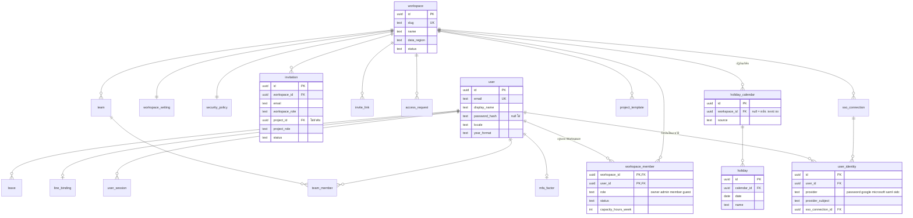
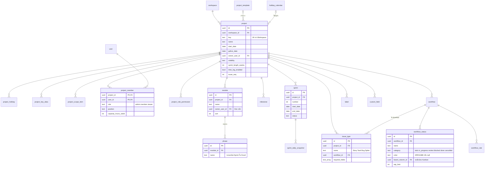
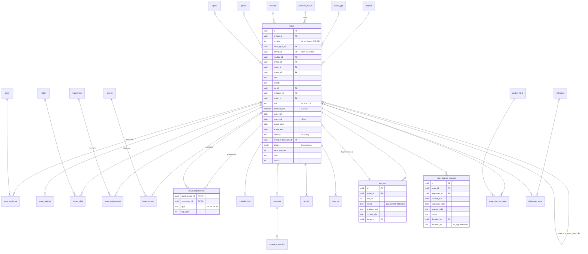
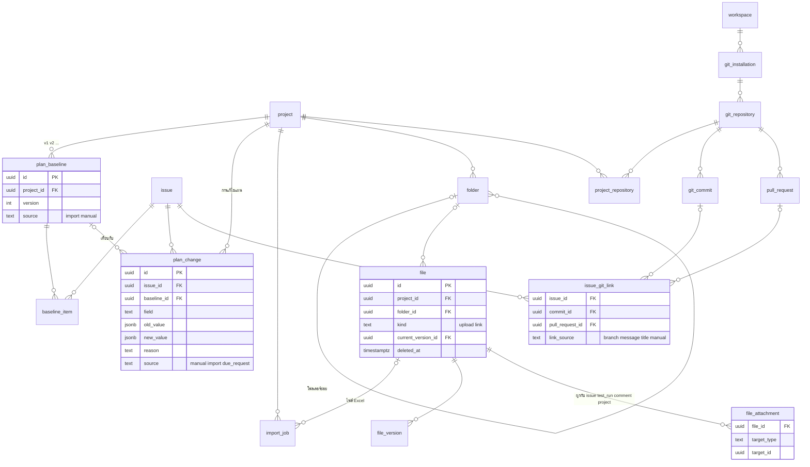
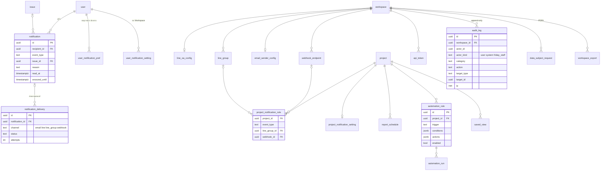
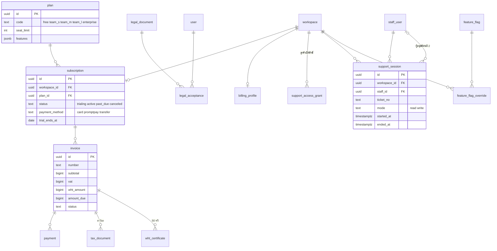

# 02 · ERD

แบ่งเป็น 6 แผนภาพตามกลุ่มของ [01-entities.md](01-entities.md) · แสดงเฉพาะ PK / FK และฟิลด์ที่ช่วยอ่านความสัมพันธ์ ฟิลด์ครบอยู่ในไฟล์ 01

GitHub แสดงแผนภาพ Mermaid ให้อัตโนมัติ

**ภาพรวม:** ผู้ใช้ 1 คน (`user`) อยู่ได้หลาย Workspace ผ่าน `workspace_member` · ข้อมูลงานทั้งหมดอยู่ใต้ `workspace` › `project` › `issue` และทุกตารางของลูกค้ามี `workspace_id` สำหรับ RLS (ในแผนภาพละไว้เพื่อให้อ่านง่าย)

## 1. ผู้ใช้, Workspace และสมาชิก

## 2. โปรเจกต์และโครงสร้างแผน

## 3. งาน (Issue)

## 4. แผน, ไฟล์ และ Git

## 5. แจ้งเตือน, Automation และ Audit

## 6. SaaS และหลังบ้านทีม Friday

